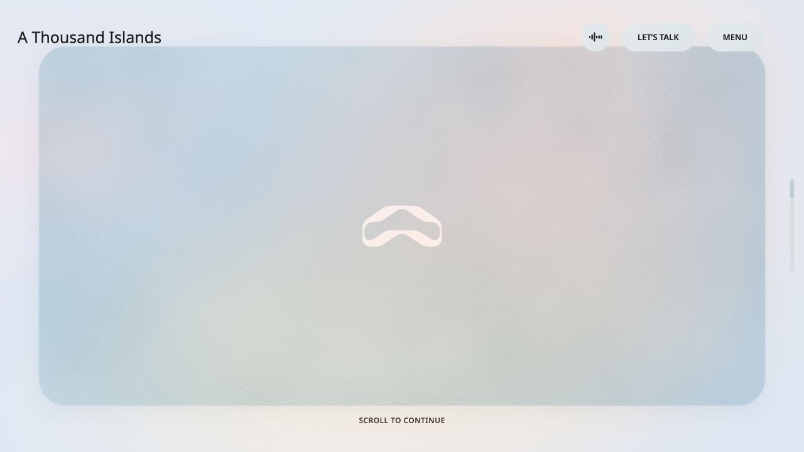
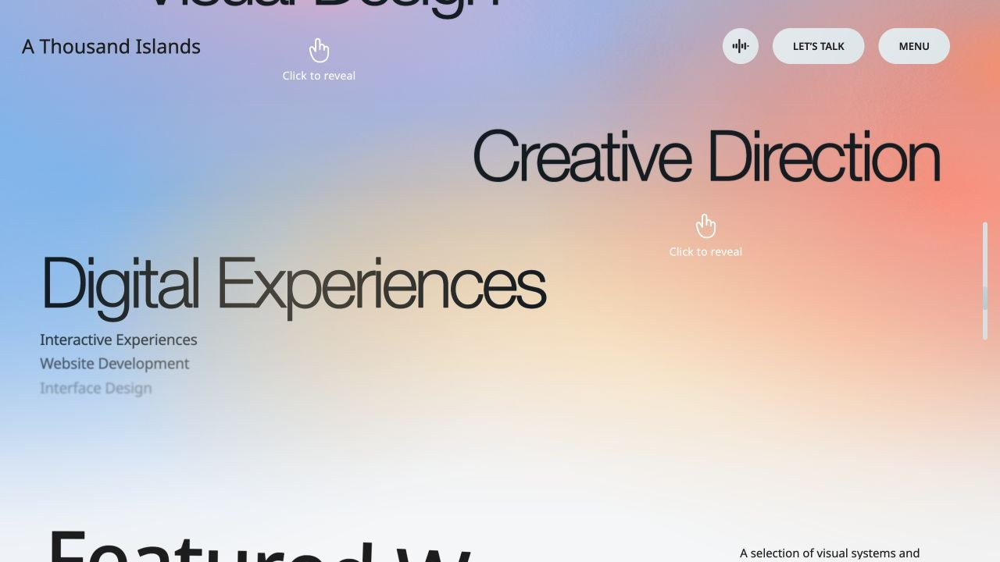

# A Thousand Islands Studio Website

I designed and built the website for A Thousand Islands, my independent creative technology studio in Nairobi. Frosted glass, colour and muffled sound carry the same idea through the site. There’s something to uncover, and you can do it at your own pace.

[Visit the studio](https://athousandislands.tech/) · [Explore the work](https://athousandislands.tech/#featured-work) · [Watch the showreel](https://athousandislands.tech/#showreel)

## Try it

Click or tap the frosted casing on the homepage, then pick a heading in [Services](https://athousandislands.tech/#services-glass) to see what sits behind it. The headings also respond to Enter and Space. Use the speaker control if you want to hear how sound responds to the reveals.

## Milestones

### 23 October 2026 · Gave the redesign its own preview

I set up a separate build for the redesign so I could review layouts, media and interactions while the existing site stayed live. The preview gave me a repeatable way to check the same build on different screen sizes before publishing. [Redesign setup](https://github.com/athousandislands/A-Thousand-Islands-Landing-Page/commit/9464d31)

### 14 November 2026 · Turned the landing page into a studio site

I brought the homepage, Services, Work and the showreel together around the frosted-glass treatment. Each piece gives visitors a different way into the studio, from revealing the introduction to opening a project. I added responsive navigation, touch and keyboard controls for the main reveals, and sound visitors can turn on when they want it. [Redesign release](https://github.com/athousandislands/A-Thousand-Islands-Landing-Page/commit/b40fe0d)

### 18 November 2026 · Made browsing recoverable when a page stalls

When a project page takes too long to load, visitors can retry or stay where they are. I also tightened how the showreel and carousels pause or reset when you move between sections. Those changes make the site easier to keep using when a connection or a video load interrupts the experience. [Navigation and media update](https://github.com/athousandislands/A-Thousand-Islands-Landing-Page/commit/09bef9d)

### 19 November 2026 · Simplified the motion and stabilized the homepage reveal

I settled on a small movement that follows the scroll for “Create Your Reality,” with a still version for people who prefer reduced motion. I also put the drifting colours on their own layer, so clicking the casing can reveal the introduction without restarting the entrance animation. [Heading motion](https://github.com/athousandislands/A-Thousand-Islands-Landing-Page/commit/c9566e2) · [Casing fix](https://github.com/athousandislands/A-Thousand-Islands-Landing-Page/commit/4939fc4)

## Next up

Check the navigation, Services reveals and showreel on physical phones and tablets, including scrolling away during playback and returning to a project.

## Development

Use Node.js 24. Run `npm ci` and `npm run dev`. Run `node --test tests/*.test.mjs` for the interaction tests and `npm run build` for the production build. See the [website notes](WEBSITE-NOTES.md) and [Vercel configuration](vercel.json).
